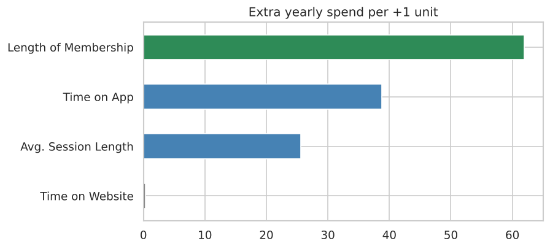
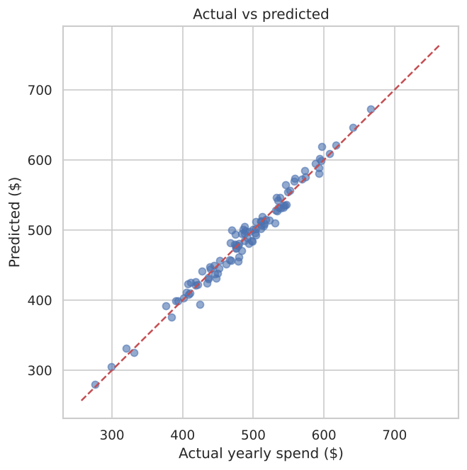
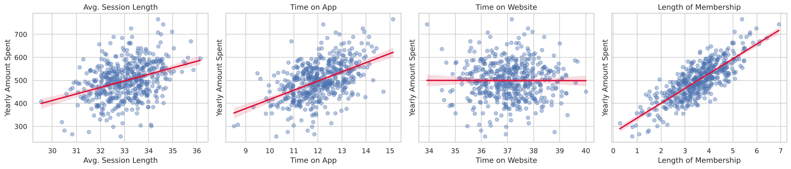

# 🛒 E-commerce Customer Spending: App or Website?

An online clothing store wants to know whether to invest in its **mobile app** or its **website**. This project models each customer's yearly spending with Linear Regression and reads the coefficients to answer that business question.



## The answer

| Feature (+1 unit) | Extra yearly spend |
|---|---|
| **Length of membership** (+1 year) | **+$61.90** |
| **Time on app** (+1 min) | **+$38.79** |
| Avg. session length (+1 min) | +$25.60 |
| Time on website (+1 min) | +$0.31 |

* Time on the **app** is worth ~125× more than time on the website.
* **Membership length** is the strongest driver → loyalty and retention matter most.
* **Recommendation:** invest in the app (or fix the website to match it), and above all keep customers longer.

## Model quality

| Metric | Score |
|---|---|
| R² (test) | **0.978** |
| 5-fold CV R² | **0.984 ± 0.002** |
| MAE | $8.56 |
| RMSE | $10.48 |

Residuals are centred at zero and roughly normal, which confirms a linear model is appropriate.

| Actual vs predicted | Features vs spending |
|---|---|
|  |  |

## Run it

```bash
pip install -r requirements.txt
jupyter notebook ecommerce_customer_spending.ipynb
```

**Data:** 500 customers (`data/Ecommerce Customers.csv`), a classic teaching dataset with synthetic customer records.

**Tech:** Python · pandas · scikit-learn · seaborn

---

## 👤 Author

**Reda Akram** — Computer Science (AI) student at the University of Technology, Baghdad. I build ML models, automation systems and AI agents.

GitHub: [@devb777r](https://github.com/devb777r)
